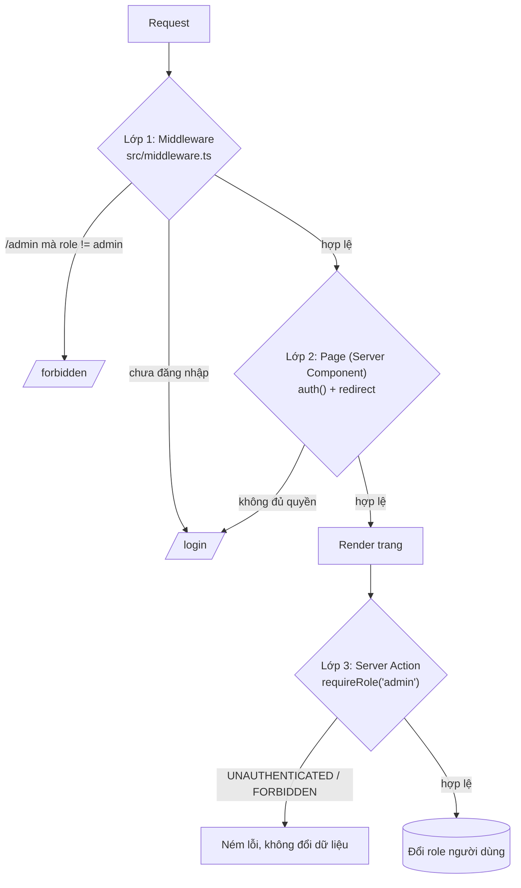

# Báo cáo BTVN 19-10: NextAuth + phân quyền + SEO

## Chạy dự án

```bash
npm install
cp .env.example .env.local   # điền GITHUB_ID / GITHUB_SECRET nếu muốn dùng OAuth
npm run dev
```

Tài khoản demo (email/mật khẩu): `admin@example.com / admin123`, `user@example.com / user123`.
Đăng nhập GitHub: email nằm trong `ADMIN_EMAILS` sẽ có role `admin`, còn lại là `user`.

## Các lớp bảo vệ



| Lớp | File | Vai trò |
|---|---|---|
| 1. Middleware | `src/middleware.ts` | Chặn sớm `/dashboard/*` (cần đăng nhập) và `/admin/*` (cần admin) |
| 2. Page | `dashboard/page.tsx`, `admin/page.tsx` | Kiểm tra lại session, phòng khi middleware bị bỏ qua hoặc matcher sai |
| 3. Server Action | `admin/actions.ts` | Action là endpoint POST công khai nên tự kiểm tra `requireRole("admin")`, validate input, không cho tự đổi role của mình |

Kiểu TypeScript cho session nằm ở `src/types/next-auth.d.ts`: mở rộng `Session.user`, `User` và `JWT` với `id` và `role: "admin" | "user"`. Nhờ vậy `session.user.role` có kiểu đầy đủ ở mọi nơi.

## SEO (2 trang công khai: `/` và `/about`)

- Canonical: `alternates.canonical` trong metadata của từng trang, kèm `metadataBase`.
- Open Graph: `opengraph-image.tsx` cho `/` và `/about/opengraph-image.tsx` (ảnh 1200x630 sinh bằng `next/og`), cùng `openGraph` trong metadata.
- JSON-LD: `WebSite` ở `/`, `AboutPage` ở `/about` (đã escape `<`).
- Bổ sung: `robots.ts` (chặn `/admin`, `/dashboard`, `/api`), `sitemap.ts`, `robots: noindex` cho trang login/dashboard/admin.

## Lighthouse (mobile, `next start` trên localhost)

| Trang | Hạng mục | Trước | Sau |
|---|---|---|---|
| `/` | Performance | 99 | 97 |
| `/` | Accessibility | 100 | 100 |
| `/` | Best Practices | 96 | 100 |
| `/` | SEO | 91 | 100 |
| `/about` | Performance | 99 | 100 |
| `/about` | Accessibility | 100 | 100 |
| `/about` | Best Practices | 96 | 100 |
| `/about` | SEO | 91 | 100 |

Báo cáo JSON gốc nằm trong `reports/` (`before-*.json`, `after-*.json`).

**"Trước"** là bản layout gọi `auth()` phía server: mọi trang bị render động, thẻ `meta description` không nằm trong `<head>` (SEO mất 9 điểm) và thiếu favicon (404 trong console làm Best Practices còn 96).
**"Sau"** là layout không đọc session ở server (navbar dùng `SessionProvider` + `useSession` ở client) nên `/` và `/about` prerender tĩnh, metadata nằm đúng trong `<head>`, và có thêm `icon.svg`.

Lưu ý: điểm Performance dao động 97-100 giữa các lần chạy (LCP 0.8-2.0 s), chênh lệch này là nhiễu đo, không phải thay đổi thật. Chưa đo trên PageSpeed Insights vì cần deploy lên URL công khai.
